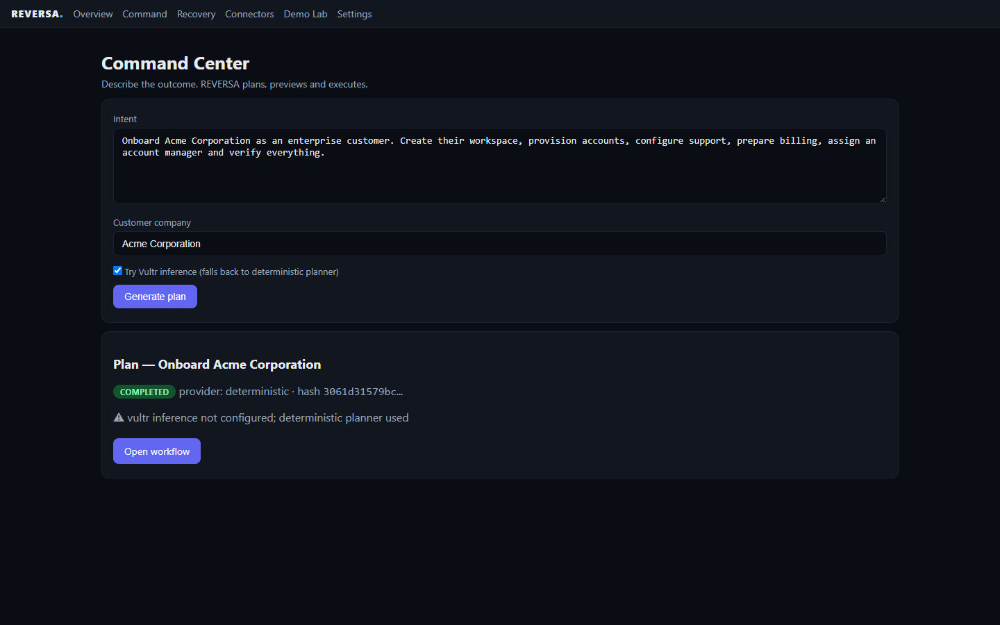
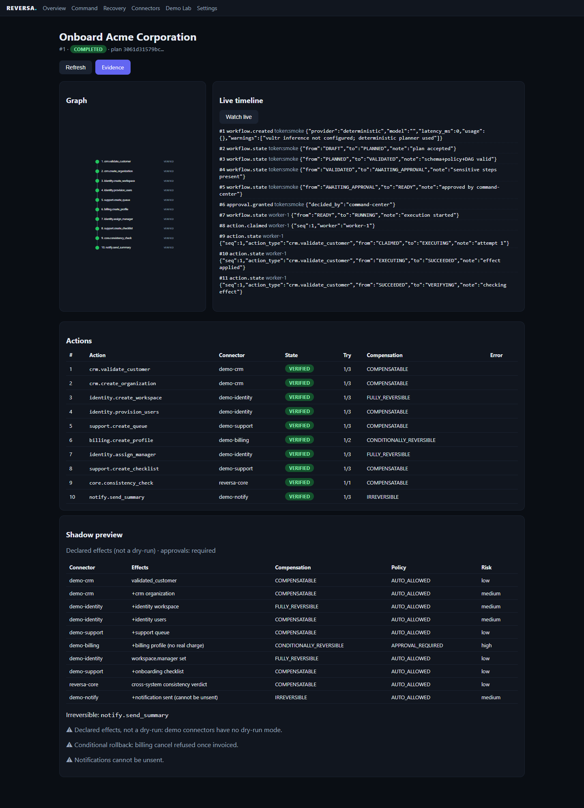
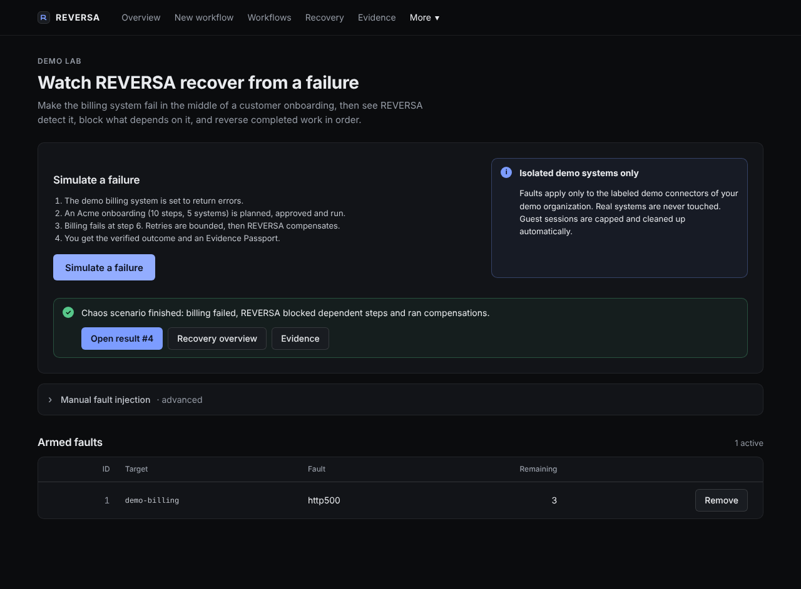
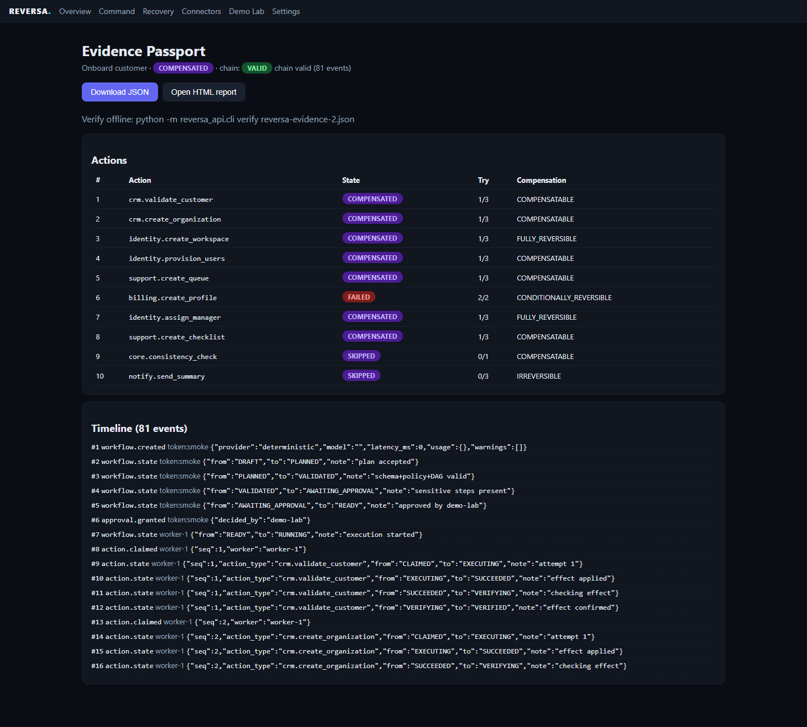

# REVERSA — Self-Healing AI Operations Platform

[](https://github.com/toskaman/reversa/actions/workflows/ci.yml)
[](LICENSE)

**AI that doesn't just act. It makes things right.**
**Reversible where possible. Accountable everywhere.**

**Live demo: [https://217.69.3.211.nip.io](https://217.69.3.211.nip.io)**
*(Challenge 2 — Powering the Future of Work, Vultr Agent Rush 2026)*

REVERSA plans multi-system business operations with AI, executes them
through authorized connectors, verifies every effect, and automatically
heals recoverable failures with typed compensations — every run sealed in
a verifiable Evidence Passport.

## The 30-second demo

1. **Command** — keep the Acme onboarding intent, generate the plan.
2. **Shadow Preview** — effects, risks, approvals. Approve.
3. **Execute** — 10 real actions across CRM, Identity, Support, Billing, Notify.
4. **Demo Lab** — INJECT FAILURE: billing dies, REVERSA detects, blocks
   dependents, compensates in reverse order, reports.
5. **Evidence** — hash-chained timeline, JSON/HTML export, offline CLI verify.






## Architecture

```text
browser ──HTTPS──> Caddy ──┬──> web:3000 (Next.js 15, TypeScript strict)
                            └──> api:8000 (FastAPI + saga worker)
                                      ├─ Postgres 16 (workflows, actions, events)
                                      ├─ 5 isolated SQLite stores (demo systems)
                                      └─ Vultr Inference (optional) / deterministic planner
```

- **Saga engine**: 15 workflow / 14 action states, allowlisted transitions,
  DB leases, idempotency keys, optimistic versions, crash reconciliation.
- **Typed compensation**: FULLY / CONDITIONALLY / COMPENSATABLE /
  IRREVERSIBLE / MANUAL_ONLY / UNKNOWN — unsafe undo is refused, with reasons.
- **Evidence**: SHA-256 hash-chained timeline, secrets redacted, exports +
  offline verifier (`python -m reversa_api.cli verify export.json`).
  VALID = prefix-consistency (no gaps/mismatches in events 1..N); strict
  mode (`--strict` with count/head anchors) rules out trailing truncation;
  exported `ts` is not hash-covered.

## Quickstart (local, no key needed)

```bash
# API (http://127.0.0.1:8000)
cd reversa/apps/api && python -m venv .venv
.venv/bin/pip install -e ".[dev]"
REVERSA_DATA_DIR=data .venv/bin/python -m uvicorn reversa_api.main:app

# Web (http://127.0.0.1:3000) — new shell
cd reversa/apps/web && npm install && npm run build && npm run start
```

Paste the demo token printed in the API log into Settings → Test connection,
then run the 30-second demo above.

## Tests & benchmarks

```bash
python -m pytest reversa/apps/api/tests/ -q        # 204 passed, 2 honest skips (V2)
python reversa/tests/e2e/smoke_browser.py --token <tok>   # 9/9 in real Chromium
python reversa/tests/performance/bench.py --base <url> --token <tok>
```

Measured on production (Vultr `vc2-2c-4gb`, Paris): onboarding P50 **505 ms**,
chaos-recovery P50 **1.78 s**, recovery rate **100 %**, chains valid 15/15.
Details: [docs/benchmarks/results.md](docs/benchmarks/results.md).

## How REVERSA uses Vultr

- **Cloud Compute** — the entire product (API, worker, web, Postgres, Caddy)
  runs on one VM; nothing executes elsewhere. ~$2 for the whole event.
- **Serverless Inference** — optional provider (OpenAI-compatible, JSON mode,
  validated plans, honest fallback). Model list verified live.

## Security & honest limits

Tenant-isolated tokens, plan-hash-bound approvals (30-min TTL), chaos locked
to the demo tenant, redacted secrets, bounded retries. No exactly-once claim
on external systems; the hash chain detects tampering but is not absolute
immutability alone. Demo systems are labeled as such.

## Docs

- [Jury dossier](docs/jury/) — overview, compliance, architecture, proofs,
  AI, security, benchmarks, business case, demo script, verification.
- [Demo video build](docs/jury/build_video.py) — 66 s from real captures.
- [LabLab texts](docs/jury/lablab-submission.md) · [Slides](docs/jury/slides.md)

MIT — built originally for this hackathon.
